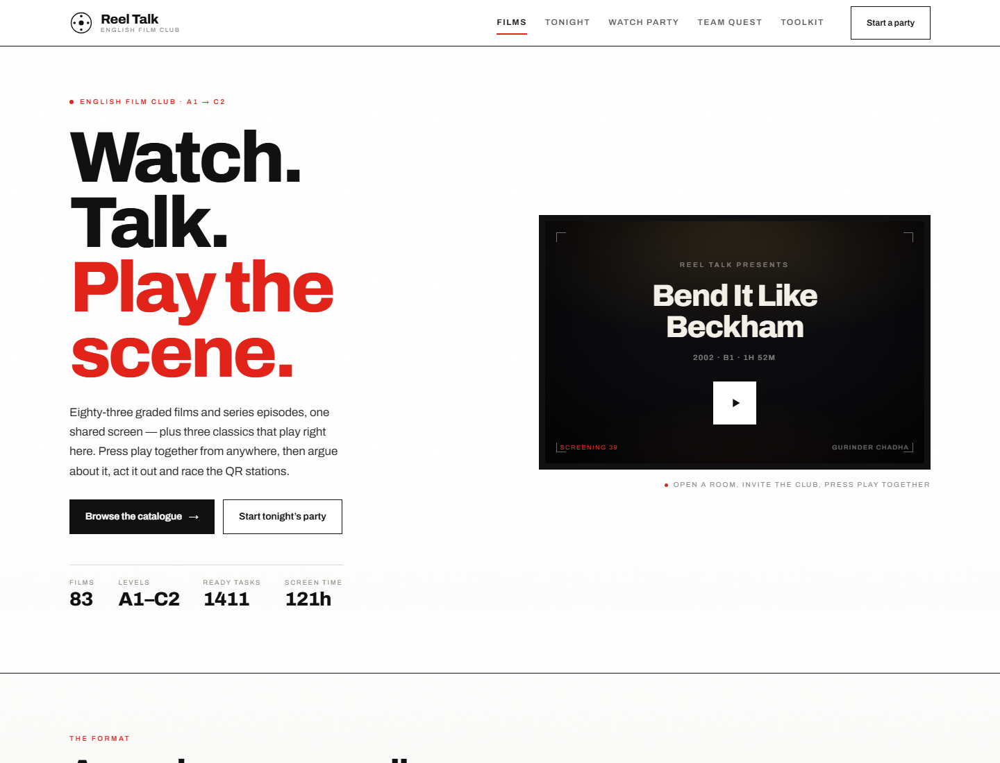
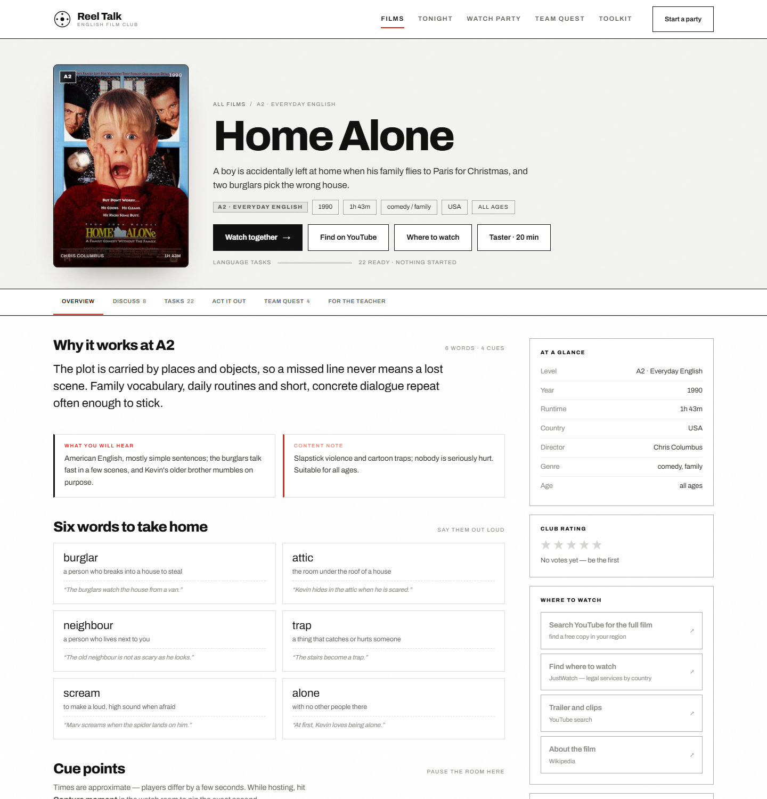
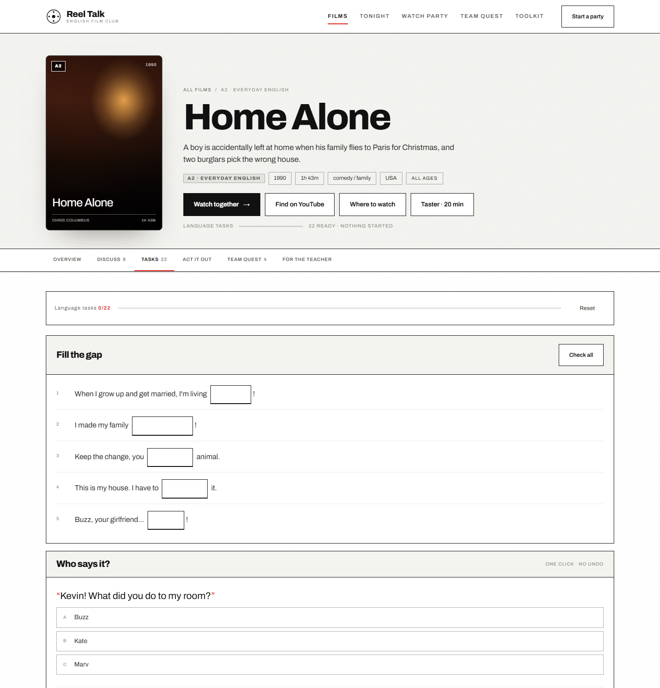
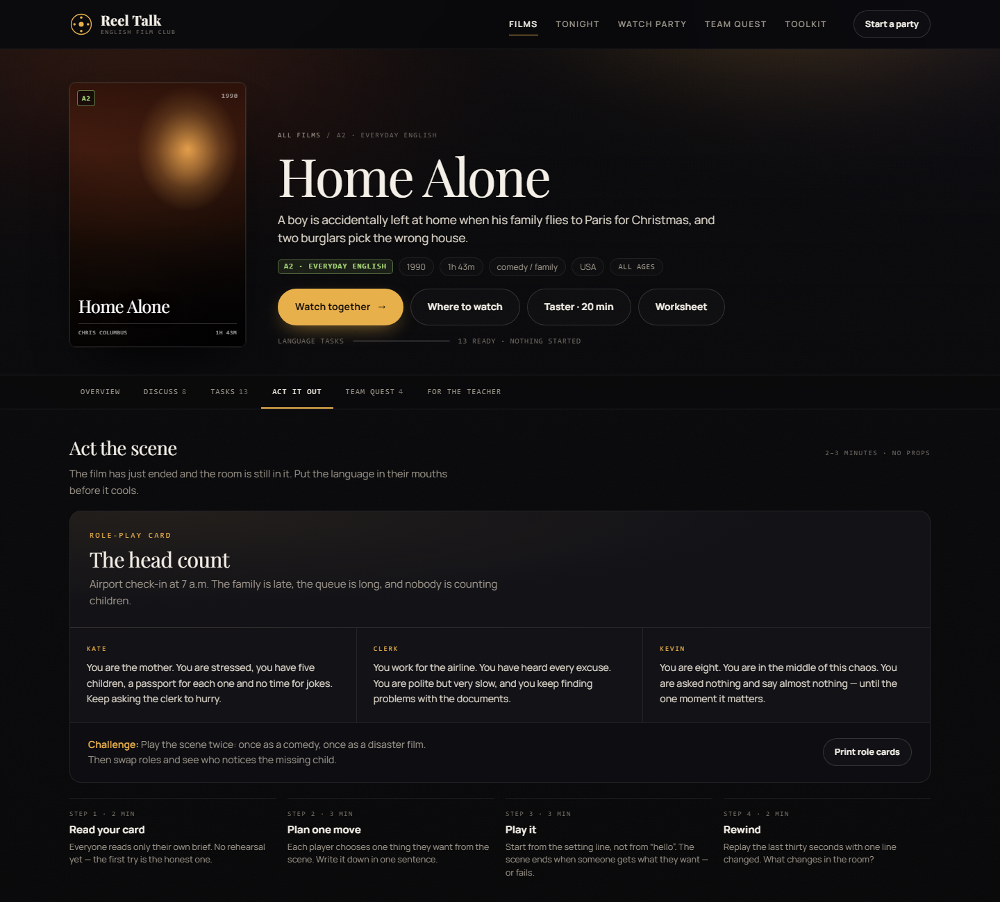
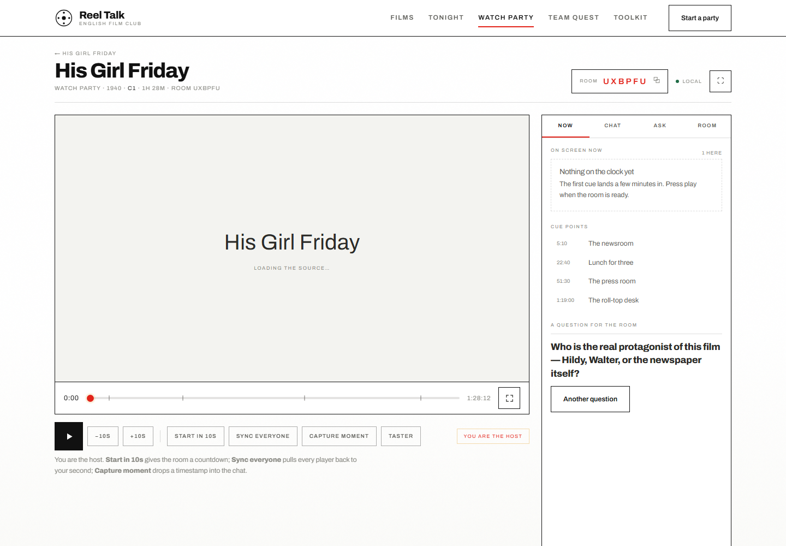
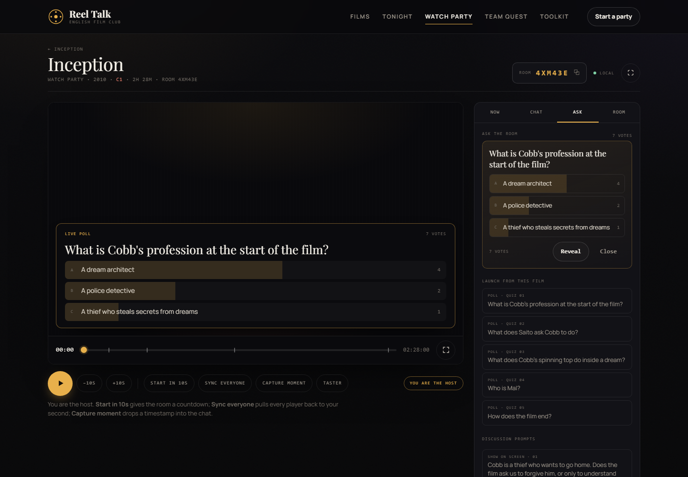
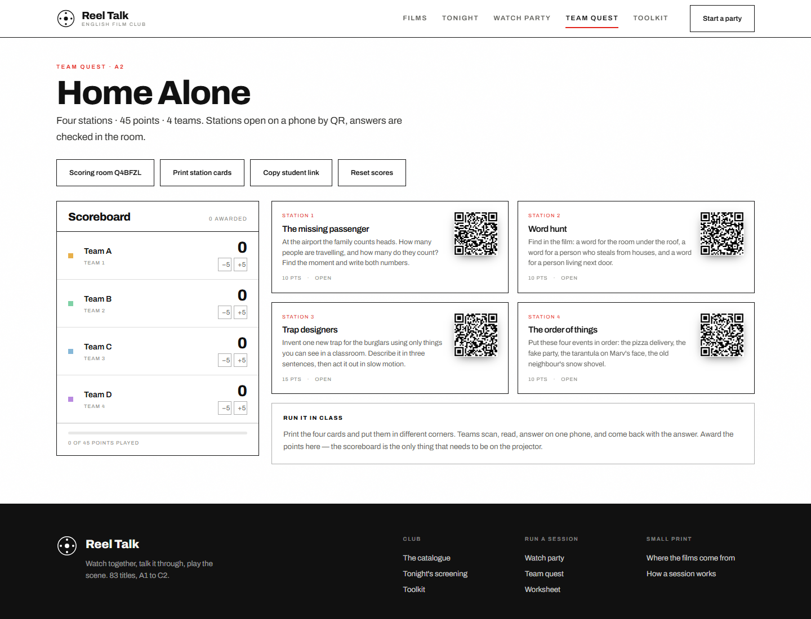
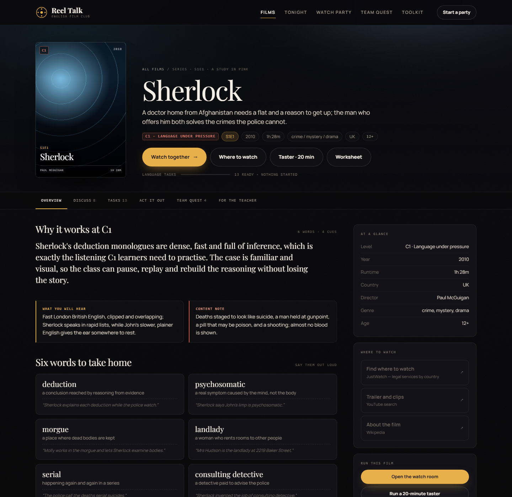
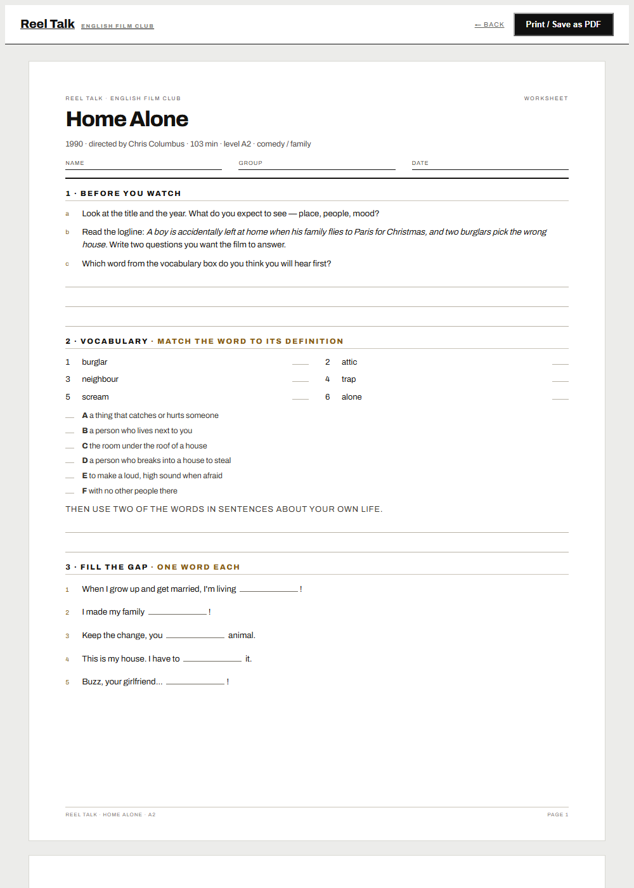
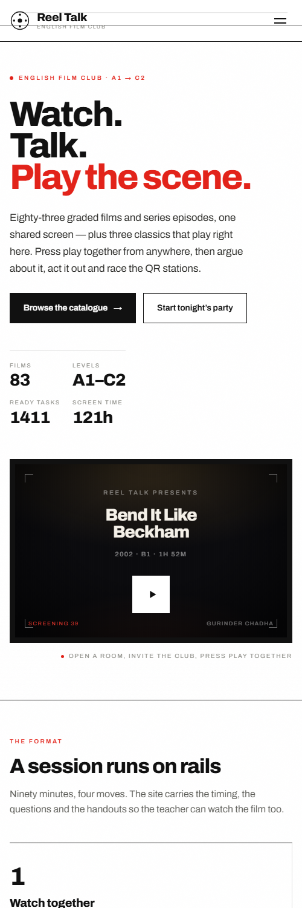

# Reel Talk — English Film Club

Сайт киноклуба для уроков английского: **83 тайтла от A1 до C2** (фильмы и эпизоды сериалов), совместный онлайн-просмотр с общим тайм-кодом, live-опросы в комнате, режим 20-минутного тизера, вопросы для обсуждения, 22 интерактивных задания на фильм, голосование за фильмы всем клубом, сценки для разыгрывания, командный квест с QR-кодами и автосчётом, печатные worksheets с ответами.

Всё статическое: ни сборки, ни базы данных, ни аккаунтов. Открывается двойным кликом по `index.html` или через локальный сервер.

---

## Быстрый старт

**Вариант 1 — просто открыть.** Двойной клик по `index.html`. Всё работает, кроме синхронизации комнаты между устройствами (браузер на `file://` не даёт открыть локальную сеть). Для одного ноутбука этого достаточно.

**Вариант 2 — сервер клуба (рекомендуется).** Двойной клик по `start.cmd` или:

```powershell
python tools/server.py 8000
```

Откройте `http://127.0.0.1:8000`. В консоли появится ещё и сетевой адрес вида `http://192.168.x.x:8000` — по нему заходят телефоны в той же Wi-Fi. На этом сервере работает настоящая синхронизация комнаты в реальном времени.

**Вариант 3 — хостинг (GitHub Pages и любой статический хостинг).** Загрузите папку как есть. Синхронизация тогда идёт через публичный relay `ntfy.sh` (см. ниже), а не через ваш сервер.

---

## Что внутри

### Каталог
- **83 тайтла**: 80 фильмов и эпизодов сериалов в основной программе + 3 фильма Open Screen, которые лицензионно стримятся прямо в комнате (public domain, Internet Archive).
- По уровням: A1 — 14, A2 — 16, B1 — 14, B2 — 14, C1 — 14, C2 — 11. Сериалы помечены бейджем `S1E1` и фильтруются переключателем **Series**.
- Фильтры по уровню, жанру, поиск по названию/режиссёру/слову, сортировка, переключатель «free to stream».
- Уровень — это не «сложность сюжета», а языковая нагрузка: A1 — короткие фильмы с ясной нарацией, C2 — периодная лексика, диалект и намеренная двусмысленность.

### Страница фильма (6 вкладок)
| Вкладка | Что там |
|---|---|
| **Overview** | почему фильм работает на этом уровне, что слышно (акцент, темп), content note, 6 слов с определениями, 4 cue-точки, где смотреть |
| **Discuss** | 8 вопросов от «что произошло» до «что бы сделали вы» + режим **Question deck** (один вопрос на весь экран, стрелки) |
| **Tasks** | 22 задания: fill the gap (5), who says it (3), comprehension quiz (5), match the word (6 пар), put the scene in order, rebuild the line (2) — с проверкой и счётом в `localStorage` |
| **Act it out** | role-play card на 2–3 роли, план на 4 шага, сцены для импровизации, печать ролевых карточек |
| **Team quest** | 4 QR-станции с заданиями и ответами, печать карточек |
| **For the teacher** | два плана вечера (90 минут «фильм дома» и «screening night»), полный answer key, копирование брифа, печать |

### Голосование за фильмы

- На странице каждого фильма — блок **Club rating**: пять звёзд, средняя оценка и число голосов.
- Голос считается один раз с устройства; можно переголосовать, оценка обновится.
- На сервере клуба оценки складываются в `tools/votes.json` и общие для всех устройств: ученики голосуют со своих телефонов, учитель видит итог.
- В каталоге появилась сортировка **Top rated by the club**.

Без сервера (просто открытый `index.html`) голос сохраняется только на этом устройстве — сайт честно показывает «1 vote from the club».

### Комната совместного просмотра (`watch.html`)
Главное: **общий тайм-код**. Кто-то один — хост, остальные следуют за ним.

- **Host controls**: play/pause, ±10s, seek, «Start in 10s» (обратный отсчёт для всех), «Sync everyone», «Capture moment» (пауза-метка уходит в чат).
- **Cue points**: сайт сам показывает, какая сцена сейчас на экране, и что спросить на этой минуте.
- **Chat**: обратный канал для догадок и «who is that?».
- **QR-вход**: QR-код комнаты — телефоны заходят одним сканом.
- **Live-опросы**: хост запускает вопрос из квиза фильма — у всех на телефоне три варианта, на проекторе живые бары с голосами, кнопка **Reveal** подсвечивает верный ответ. Можно вывести на экран любой вопрос для обсуждения (`Ask` → Show on screen).
- **20-минутный тизер**: три отрывка по 2,5 минуты из cue-точек. Комната сама ставит паузу в конце каждого и показывает задание — формат, который влезает в школьный урок.
- **Три источника**: прямой видеофайл (mp4/webm), YouTube-ссылка, либо «внешний плеер» — когда фильм лежит в Netflix/Кинопоиске и каждый смотрит у себя.

Три режима связи (переключаются автоматически):

| Режим | Когда работает | Что даёт |
|---|---|---|
| **Club server** | запущен `tools/server.py` | настоящий realtime по SSE, все команды хоста мгновенно |
| **Public relay** | статический хостинг, есть интернет | realtime через `ntfy.sh`, без своего сервера |
| **This device only** | нет сети / один ноутбук | синхронизация вкладок через `BroadcastChannel` |

Если relay недоступен, комната сама через 5 секунд переходит в режим одного устройства и честно об этом пишет.

### Командный квест (`quest.html`)
- 4 станции на фильм, 2–4 команды, счёт на экране учителя; ответы со станций приходят автоматически и подсвечивают станцию как сданную.
- Печать карточек станций с QR (A4, 2×2) и ролевых карточек.
- Станция на телефоне: задание → ответ → проверка → выбор команды. Очки сами прилетают на табло учителя по сети, вручную вносить не нужно.
- Ответы проверяются мягко (по ключевым словам), чтобы не наказывать за артикли.

### Печать (`print.html`)
- Worksheet на 3 страницы: before you watch + vocabulary + fill the gap · who says it + comprehension + discussion · act the scene + team quest + short review + notes.
- Answer key отдельной страницей.
- Ролевые карточки для разрезания.
- QR-карточки станций для квеста.
- Кнопка **Print / Save as PDF** — печать через браузер, поля A4 уже настроены.

---

## Как это устроено

```
reel-talk/
├─ index.html          каталог
├─ film.html           страница фильма   #/f/<id>/<tab>
├─ watch.html          комната           ?room=CODE&host=1#/w/<id>
├─ quest.html          квест             #/build/<id> · #/s/<id>/<n>
├─ print.html          печать            #/ws/<id> · #/ws/<id>/key · #/ws/<id>/roles · #/quest/<id>
├─ css/                app.css (дизайн-система), film.css, watch.css, quest.css, print.css, fonts.css
├─ js/
│  ├─ data/films.js    собранные данные (генерируется)
│  ├─ core.js          данные, хелперы, постеры, шапка/подвал, модалки, QR
│  ├─ home.js  film.js  watch.js  quest.js  print.js
│  ├─ sync.js          три транспорта: server / cloud / local
│  └─ vendor/qrcode.js QR-генератор Kazuhiko Arase (MIT), работает офлайн
├─ content/
│  ├─ _plan.md         список 83 тайтлов (id, год, режиссёр, минуты, уровень)
│  ├─ _schema.md       схема данных и правила написания
│  ├─ _example.json    эталонный объект (Home Alone)
│  └─ films/*.json     исходники: a1, a2, b1, b2, c1, c2, open
├─ tools/
│  ├─ build_data.py    JSON → js/data/films.js
│  ├─ check_films.py   валидатор схемы
│  ├─ server.py        статический сервер + realtime-хаб (только stdlib)
│  ├─ test-sync.html   автотест синхронизации в браузере
│  └─ shot.ps1         скриншоты для превью
└─ preview/            скриншоты
```

### Данные
Один фильм — один объект в `content/films/<level>.json`:

`id, title, year, level, runtime, genres, director, country, age, mood, logline, why, language, content, scenes[4], words[6], questions[8], gaps[5], quotes[3], quiz[5], roleplay, quest[4]`

Правила и примеры — в `content/_schema.md` и `content/_example.json`.

**Добавить фильм:**
1. дописать объект в нужный `content/films/*.json` (id — kebab-case, как в `_plan.md`);
2. `python tools/check_films.py content/films/b1.json` — должно быть 0 errors;
3. `python tools/build_data.py` — пересоберёт `js/data/films.js`.

Валидатор проверяет обязательные поля, количество заданий, диапазоны тайм-кодов, индексы правильных ответов, уникальность id и отсутствие кириллицы в англоязычном контенте.

### Постеры
Постеров нет и не будет: чужие кадры и афиши — это чужая лицензия. Вместо них — типографическая система: палитра настроения (`mood`), геометрический мотив (`motif` вычисляется из id) и название фильма шрифтом Playfair Display. 64 варианта, которые выглядят как один издательский ряд.

### Cue-точки
Время в заданиях **приблизительное** (±несколько секунд, плееры и версии фильма отличаются). В комнате есть кнопка **Capture moment** — она фиксирует реальную секунду и отправляет её в чат. В interface это честно помечено знаком «≈».

---

## Тест синхронизации

В браузере: `http://127.0.0.1:8000/tools/test-sync.html?relay=none`

Страница открывает две комнаты в iframe (хост и гость), нажимает play/pause/seek, ловит момент, проверяет чат, задания, live-опрос (запуск → голос гостя → подсчёт → reveal → prompt), тизер и автосчёт квеста (станция → табло). Результат — список PASS/FAIL на экране. Последний прогон: **31/31 PASS** (включая drills и голосование).

Проверить сервер отдельно:

```powershell
python tools/server.py 8899
# в другом окне
curl http://127.0.0.1:8899/api/health
```

---

## Про фильмы и лицензии

Сайт **не хранит и не раздаёт фильмы**. Каждая страница ведёт на легальные источники: JustWatch (где смотреть в вашей стране), официальный трейлер, Wikipedia. Три фильма Open Screen — public domain, они стримятся с серверов Internet Archive и встроены в комнату, потому что это законно.

Если фильма нет в вашем регионе — клуб всё равно работает: комната синхронизирует часы, а не картинку. Каждый смотрит свою лицензионную копию.

---

## Дизайн

Направление — **Archive**: белый, чёрный и один красный `#e2231a`, шрифт **Archivo** (локальный, без интернета), нулевые радиусы, жёсткие линейки и крупные цифры. Постеры висят на белом как в киноархиве, печатные материалы продолжают ту же сетку. Тёмный экран остался только у плеера — как настоящий экран в светлом зале.

Числа в интерфейсе без ведущих нулей: «5:10», а не «05:10»; «станция 2», а не «станция 02»; шаги «1 2 3 4».

Все три варианта направления сохранены для истории в `preview/design-directions.html` (A · Archive, B · Screening room, C · Poster).

## Ограничения, о которых стоит знать

- **Тайм-коды приблизительные.** Ставьте метку кнопкой Capture, если нужна точность.
- **Публичный relay** (`ntfy.sh`) — бесплатный и без регистрации, но у него есть лимиты на сообщения. Для длинного вечера лучше свой сервер.
- **YouTube-источник** управляется через postMessage: пауза и seek работают, но точную позицию сайт не читает — часы ведёт хост.
- **Прогресс и счёт квеста** живут в `localStorage` браузера: у каждого устройства свой. Это осознанно — аккаунтов нет.
- **A1-фильмы** — короткометражки, у нескольких почти нет диалогов. Это не баг: такие фильмы берут языком картинки, и задания построены на описании, а не на цитатах.

---

## Превью

| | |
|---|---|
|  |  |
|  |  |
|  |  |
|  |  |
|  |  |
